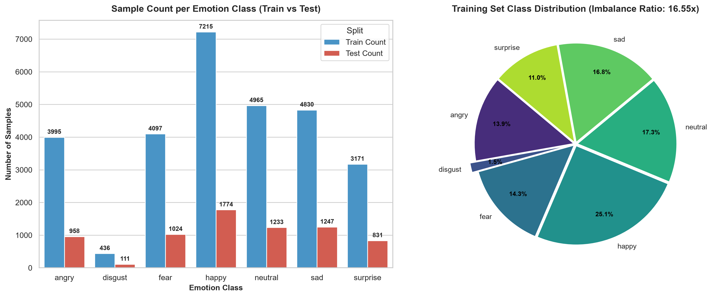
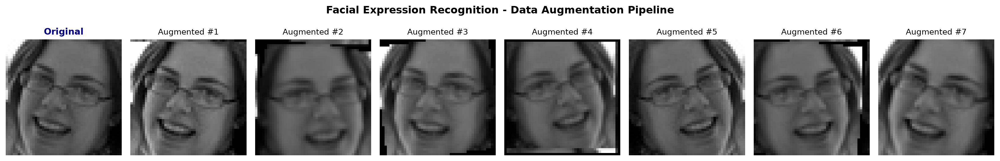

# Facial Expression Recognition (FER)

A Deep Learning project for recognizing human facial expressions from images and real-time video streams.

## Project Structure

```
facial-expression-recognition/
│
├── dataset/
│   ├── train/                   # Training dataset divided by emotion classes
│   └── test/                    # Testing / Validation dataset divided by emotion classes
│
├── src/                         # Source code modules
│   ├── data/                    # Data loading, augmentation, and preprocessing scripts
│   ├── models/                  # Neural network model architectures (CNNs, Transfer Learning)
│   ├── training/                # Training pipelines, callbacks, and loss functions
│   ├── evaluation/              # Model evaluation metrics, confusion matrix, classification report
│   └── realtime/                # Real-time webcam face detection and emotion inference
│
├── experiments/                 # Experiment notes, notebooks, and trial logs
│
├── results/
│   ├── graphs/                  # Training history plots (Accuracy, Loss curves)
│   └── confusion_matrix/        # Confusion matrices and evaluation plots
│
├── models/                      # Saved trained models (.keras, .h5, etc.)
│
├── report/                      # Project documentation, presentations, and reports
│
├── requirements.txt             # Project dependencies
├── README.md                    # Project overview and setup instructions
└── .gitignore                   # Git ignore configuration
```

## Dataset Emotion Classes

The dataset is categorized into the following 7 emotion categories:
- `angry` (Train: 3,995 | Test: 958)
- `disgust` (Train: 436 | Test: 111)
- `fear` (Train: 4,097 | Test: 1,024)
- `happy` (Train: 7,215 | Test: 1,774)
- `neutral` (Train: 4,965 | Test: 1,233)
- `sad` (Train: 4,830 | Test: 1,247)
- `surprise` (Train: 3,171 | Test: 831)

### Class Distribution & Imbalance Analysis
Total 35,887 samples across train (28,709) and test (7,178) splits. Imbalance ratio is 16.55x (Happy vs Disgust).


### Data Preprocessing & Augmentation Pipeline
Normalization ([0, 1]), contrast enhancement (histogram equalization), and domain-specific facial augmentations:


## Getting Started

### 1. Prerequisites
Ensure you have Python 3.9+ installed.

### 2. Create and Activate a Virtual Environment
```bash
# Windows
python -m venv venv
venv\Scripts\activate

# macOS / Linux
python3 -m venv venv
source venv/bin/activate
```

### 3. Install Dependencies
```bash
pip install -r requirements.txt
```

## Workflow Overview

1. **Data Preprocessing**: Prepare and augment image data under `src/data/`.
2. **Model Architecture**: Define custom CNN or transfer learning models under `src/models/`.
3. **Training**: Train models with checkpointing and learning rate scheduling under `src/training/`.
4. **Evaluation**: Assess accuracy, generate confusion matrices, and evaluate metrics under `src/evaluation/`.
5. **Real-Time Detection**: Run live facial expression recognition using OpenCV under `src/realtime/`.
